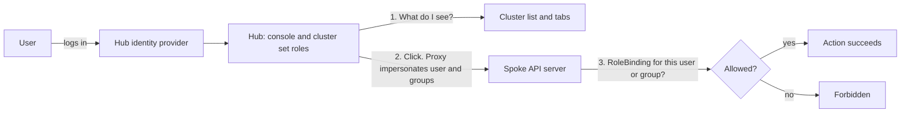

# RBAC for an ACM fleet

Present the sections through the checklist. Everything after that is reference.

## TL;DR

1. **Two planes, two grants.** A hub role decides what you see. A spoke binding decides what you can do. You need both.
2. **Bind groups, not people.** The same group name must exist on the hub token and in the spoke bindings. Add or remove a person in the group to grant or revoke access.
3. **Cluster sets control visibility.** A `ManagedClusterSet` is the set of clusters a team may see and target.
4. **`MulticlusterRoleAssignment` is the central grant.** One object on the hub says who gets which role, on which clusters, in which namespaces. It is GA for OpenShift Virtualization. Logging and metrics scoping through the same object is not GA yet.
5. **RBAC cannot say "only this field."** For a rule such as "a namespace admin may add only one label," use admission control on the cluster that owns the object.

**If you only do one thing:** use one central identity provider, bind groups on both planes, and name groups per zone or team (for example `zonea-vm-admins`).

## How a console click is authorized



The hub role fills the list. Opening the object still fails when the spoke has no binding for the same group. The hub must be self-managed (`local-cluster`).

## Worked example: Zone A virtual machine admins

Goal: the people in group `zonea-vm-admins` may administer virtual machines on Zone A clusters, without being cluster-admin.

| Step | Where | What |
| --- | --- | --- |
| 1 | Identity provider | Put the people in group `zonea-vm-admins`. |
| 2 | Hub | Give the group cluster set `view` for Zone A, and `acm-vm-fleet:view`, so the clusters and the Virtualization tab appear. |
| 3 | Spokes | One `MulticlusterRoleAssignment` for that group, with `kubevirt.io:admin` and `acm-vm-extended:admin`, placed on the Zone A clusters. |
| 4 | Revoke | Remove a person from the group. The bindings stay. |

`fine-grained-rbac` is off by default on the `MultiClusterHub` in ACM 2.16 and 2.17. Enable it before step 3, or the `acm-vm-*` roles do not exist. The command is in the appendix.

## Three layers

**Groups** name the people. Use one central identity provider on the hub and the spokes. The same person has the same username everywhere.

**A cluster set** decides which clusters they see. For a set named `zone-a`, ACM creates:

- `open-cluster-management:admin:zone-a`
- `open-cluster-management:view:zone-a`

Bind `open-cluster-management:view:zone-a` to the group with a RoleBinding in the namespace that holds the `ManagedClusterSetBinding`. `view` shows the clusters. It does not grant virtual machines. `open-cluster-management-global-set` can see every cluster. Use it for platform owners, not for a tenant.

**`MulticlusterRoleAssignment`** grants the role on those clusters. One object on the hub. The controller creates the bindings on the spokes. It is GA for OpenShift Virtualization. The same object will scope LogQL and PromQL later. That path is not GA yet.

## The one limit

RBAC can allow "update namespaces." It cannot allow "only this label." That rule is admission control (Gatekeeper or Kyverno) on the cluster that owns the object. Templates are in the appendix. Apply them in `dryrun` first.

## Checklist

1. Confirm one identity provider and agree on group names (zone- or team-qualified).
2. Enable `fine-grained-rbac` on the `MultiClusterHub` if you need the virtualization roles.
3. Create `ManagedClusterSet`s and bind them to team namespaces. Give groups cluster set `view`.
4. Grant hub console roles, for example `acm-vm-fleet:view`.
5. Create one `MulticlusterRoleAssignment` per group for spoke access.
6. Add admission policies, dry run first, only where RBAC cannot express the rule.
7. Document a break-glass administrator for each spoke.

---

# Reference

## Glossary

| Term | Plain meaning |
| --- | --- |
| **RBAC** | Who (subject) may do what (role) where (binding). |
| **Subject** | A user, group, or service account. In Kubernetes it is a name string. |
| **Role / ClusterRole** | A list of allowed actions, for example "view virtual machines." |
| **RoleBinding / ClusterRoleBinding** | Attaches a role to a subject, in one namespace or cluster-wide. |
| **Hub** | The central ACM cluster. It runs the console. |
| **Spoke** | A managed cluster. It enforces access on its own API server. |
| **ManagedClusterSet** | A named group of clusters. It scopes what a team can see. |
| **Placement** | A rule that selects clusters from sets bound to its namespace. |
| **Impersonation** | The hub console calls the spoke as the logged-in user and their groups. |
| **Admission control** | A check that runs after RBAC allows a request, and can reject a specific change. |

## Identity patterns

| Situation | Recommendation |
| --- | --- |
| Default | One central identity provider on the hub and every spoke. Bind groups. |
| Direct spoke login is forbidden | Hub groups and spoke bindings, no user identity provider on the spokes. The console still works. `oc login` does not. Keep a break-glass administrator for when the hub is down. |
| Per-user access on spokes | Do not create a ServiceAccount per hub user. The console impersonates the user and their groups. |
| Two zones with different directories | Bind zone-qualified groups such as `zonea-vm-admins`. An unqualified `AP001` binding grants both people. |

The same short name in two directories is one subject. `AP001` on the hub and `AP001` on the spoke share every binding that names `AP001`.

## Cluster set detail

The pattern is `open-cluster-management:admin:<managed-cluster-set>` and `open-cluster-management:view:<managed-cluster-set>`. A Placement only selects clusters from sets bound to its namespace. A placement aimed at a cluster that lacks the target ClusterRole makes the console fail with `clusterrole ... not found`.

## MulticlusterRoleAssignment detail

| Consumer | Status | What happens |
| --- | --- | --- |
| OpenShift Virtualization | GA | The controller creates the `RoleBinding` or `ClusterRoleBinding` on each selected managed cluster. |
| MultiClusterLogging | Not GA yet | The query path will read the assignment and inject cluster and namespace scope into LogQL. |
| MultiClusterMetrics | Not GA yet | The same scope will be injected into PromQL. |

Rules of thumb:

- The ClusterRole must already exist on the managed cluster.
- The Placement must exist first and should select only clusters in the right `ManagedClusterSet`.
- A namespace-level assignment does not grant the role in any project not listed in `targetNamespaces`.
- Prefer one `MulticlusterRoleAssignment` per group, with several `roleAssignments`, not one object per user. Many assignments for the same clusters are combined into one `ClusterPermission` and can hit the ManifestWork size limit.

## Observability

Collectors run as addon service accounts. The person querying does not borrow that identity. Today, what someone can query follows the clusters their cluster set role allows them to see. Later, logging and metrics will use a `MulticlusterRoleAssignment` for that scope. There will not be a separate observability role API.

Logs need a tighter rule than metrics. A metric is a number. A log line can contain tokens, audit events, and virtual-machine console output. Permission to graph a virtual machine is a different decision from permission to read its console.

## Applications

Application RBAC is several patterns, not one ClusterRole. They share one property: an `ApplicationSet` can live in any namespace, not only in `openshift-gitops`. The GitOps instance must watch those namespaces (`sourceNamespaces`). Access is then namespace RBAC on `Application` and `ApplicationSet`, plus an `AppProject` that limits destination clusters and namespaces.

Cluster set `view` is still required so the Placement inside the ApplicationSet can see clusters. Creating an ApplicationSet does not make the user an admin of the destination cluster.

| Pattern | How it works |
| --- | --- |
| Team namespace owns the ApplicationSet | The group can create `ApplicationSet` and `Application` only in their namespace, using a Placement limited to their cluster set. |
| Generated Applications stay in that namespace | RBAC on `Application` in that namespace is the control. The `AppProject` bounds where they may deploy. |
| Hub push | The ApplicationSet runs on the hub. Spoke rights are the GitOps identity on the destination, plus any workload role from a `MulticlusterRoleAssignment`. |
| Spoke-local ApplicationSet | Runs on the managed cluster. RBAC is local to the spoke. |

`open-cluster-management:subscription-admin` is the older hub role for Subscriptions that fan out from a channel. It does not replace spoke namespace rights for the workload.

## Virtualization

| Who | Hub | Each managed cluster |
| --- | --- | --- |
| Viewer | `acm-vm-fleet:view` | `kubevirt.io:view` and `acm-vm-extended:view` |
| VM administrator (not cluster-admin) | `acm-vm-fleet:view` | `kubevirt.io:admin` and `acm-vm-extended:admin` |
| Cross-cluster live migration | `acm-vm-fleet:admin` | On source and destination: `kubevirt.io:admin`, `acm-vm-extended:admin`, and cluster-scoped `acm-vm-cluster-migration:view` |

`acm-vm-fleet:*` opens the Virtualization tab. It does not grant `virtualmachines` on a spoke. `kubevirt.io:admin` includes `HyperConverged` in `openshift-cnv`. It is not OpenShift `cluster-admin`.

In-cluster migration panels still need `migrations.kubevirt.io:view`, `migrations.kubevirt.io:storagemigrate`, and `migrations.kubevirt.io:storagemigrate-multins` until those rules are folded into the extended roles. Confirm the multins name with `oc get clusterrole`. The console has shown an underscore (`storagemigrate_multins`). [ACM-47215](https://redhat.atlassian.net/browse/ACM-47215) uses a hyphen.

OpenShift Virtualization still aggregates `kubevirt.io:admin` into the namespace `admin` role unless you opt out. On 4.22, `spec.roleAggregationStrategy: Manual` is that opt-out, and it is Developer Preview. Set it only after the explicit bindings exist.

Do not bind the retired names `kubevirt.io-acm-managed:*` or `kubevirt.io-acm-hub:*`.

## Policies

A policy can create and remove the spoke binding. It cannot split two people who share a username, and it cannot add anyone to a directory.

- Enforce the `ClusterRoleBinding` for the zone group. `pruneObjectBehavior: DeleteIfCreated` removes it when you delete it from the policy.
- Place the policy only on clusters in that cluster set where the ClusterRole exists.
- A second policy, placed only on `local-cluster`, binds the same group to the hub console role.
- You can also enforce the `MulticlusterRoleAssignment` itself with a policy aimed at the hub. The controller still creates the spoke bindings.
- Revoke one person by removing them from the hub group. Revoke the zone by removing the binding from the policy.

## Centralized versus admission control

| | Centralized | Admission control |
| --- | --- | --- |
| Declared | One `MulticlusterRoleAssignment` on the hub | A Gatekeeper `ConstraintTemplate` or Kyverno policy on the cluster that owns the object |
| Decided | Spoke binding for OpenShift Virtualization today. Query API for logging and metrics later | On that cluster, after RBAC has already allowed the request |
| Answers | "May this group update namespaces on these clusters?" | "This namespace admin may update the namespace, and the only label they may add is `argocd.argoproj.io/managed-by`." |
| Cannot express | Field-level limits | Who may call the API at all |

ACM can copy an admission policy out to spokes. Only the distribution is central. The decision still runs on the spoke.

---

# Appendix

## A. Enable fine-grained RBAC

```bash
oc patch mch multiclusterhub -n open-cluster-management --type=json \
  -p='[{"op": "add", "path": "/spec/overrides/components/-", "value": {"name": "fine-grained-rbac", "enabled": true}}]'
```

If `fine-grained-rbac` is already listed, set that entry to `enabled: true`.

## B. MulticlusterRoleAssignment, cluster-wide

`targetNamespaces` is omitted, so the controller creates a `ClusterRoleBinding` on each selected cluster.

```yaml
apiVersion: rbac.open-cluster-management.io/v1beta1
kind: MulticlusterRoleAssignment
metadata:
  name: zonea-vm-admins
  namespace: site-virt
spec:
  subject:
    kind: Group
    name: zonea-vm-admins
    apiGroup: rbac.authorization.k8s.io
  roleAssignments:
    - name: kubevirt-admin
      clusterRole: kubevirt.io:admin
      clusterSelection:
        type: placements
        placements:
          - name: remote-vm-sites
            namespace: site-virt
```

## C. MulticlusterRoleAssignment, namespace level

The controller creates a `RoleBinding` in each listed namespace, and nowhere else on the spoke.

```yaml
apiVersion: rbac.open-cluster-management.io/v1beta1
kind: MulticlusterRoleAssignment
metadata:
  name: zonea-vm-namespace-admins
  namespace: site-virt
spec:
  subject:
    kind: Group
    name: zonea-vm-namespace-admins
    apiGroup: rbac.authorization.k8s.io
  roleAssignments:
    - name: kubevirt-admin
      clusterRole: kubevirt.io:admin
      targetNamespaces:
        - team-a-vms
        - team-b-vms
      clusterSelection:
        type: placements
        placements:
          - name: remote-vm-sites
            namespace: site-virt
    - name: extended-admin
      clusterRole: acm-vm-extended:admin
      targetNamespaces:
        - team-a-vms
        - team-b-vms
      clusterSelection:
        type: placements
        placements:
          - name: remote-vm-sites
            namespace: site-virt
```

## D. ACM Policy that enforces the spoke binding

```yaml
apiVersion: policy.open-cluster-management.io/v1
kind: Policy
metadata:
  name: zonea-vm-admins
  namespace: open-cluster-management-global-set
spec:
  remediationAction: enforce
  disabled: false
  pruneObjectBehavior: DeleteIfCreated
  policy-templates:
    - objectDefinition:
        apiVersion: policy.open-cluster-management.io/v1
        kind: ConfigurationPolicy
        metadata:
          name: zonea-vm-admins-kubevirt
        spec:
          remediationAction: enforce
          severity: high
          object-templates:
            - complianceType: musthave
              objectDefinition:
                apiVersion: rbac.authorization.k8s.io/v1
                kind: ClusterRoleBinding
                metadata:
                  name: zonea-vm-admins-kubevirt
                roleRef:
                  apiGroup: rbac.authorization.k8s.io
                  kind: ClusterRole
                  name: kubevirt.io:admin
                subjects:
                  - kind: Group
                    apiGroup: rbac.authorization.k8s.io
                    name: zonea-vm-admins
---
apiVersion: cluster.open-cluster-management.io/v1beta1
kind: Placement
metadata:
  name: zonea-clusters
  namespace: open-cluster-management-global-set
spec:
  predicates:
    - requiredClusterSelector:
        labelSelector:
          matchLabels:
            zone: zonea
  tolerations:
    - key: cluster.open-cluster-management.io/unreachable
      operator: Equal
    - key: cluster.open-cluster-management.io/unavailable
      operator: Equal
---
apiVersion: policy.open-cluster-management.io/v1
kind: PlacementBinding
metadata:
  name: zonea-vm-admins
  namespace: open-cluster-management-global-set
placementRef:
  apiGroup: cluster.open-cluster-management.io
  kind: Placement
  name: zonea-clusters
subjects:
  - apiGroup: policy.open-cluster-management.io
    kind: Policy
    name: zonea-vm-admins
```

## E. Gatekeeper: namespace admin may add one label

```yaml
apiVersion: templates.gatekeeper.sh/v1beta1
kind: ConstraintTemplate
metadata:
  name: k8snamespacelabel
spec:
  crd:
    spec:
      names:
        kind: K8sNamespaceLabel
  targets:
    - target: admission.k8s.gatekeeper.sh
      rego: |
        package namespacelabel

        violation[{"msg": msg}] {
          input.review.operation == "UPDATE"
          input.review.kind.kind == "Namespace"
          not contains(lower(input.review.object.metadata.name), "openshift")
          not startswith(input.review.userInfo.username, "system:")
          added := { key |
            input.review.object.metadata.labels[key]
            not input.review.oldObject.metadata.labels[key]
          }
          count(added) > 0
          label := added[_]
          label != "argocd.argoproj.io/managed-by"
          msg := sprintf("Added label '%v' is not allowed on namespace '%v'. Only 'argocd.argoproj.io/managed-by' is permitted.", [label, input.review.object.metadata.name])
        }
---
apiVersion: constraints.gatekeeper.sh/v1beta1
kind: K8sNamespaceLabel
metadata:
  name: namespace-admin-one-label
spec:
  enforcementAction: dryrun
  match:
    kinds:
      - apiGroups: [""]
        kinds: ["Namespace"]
```

## F. Gatekeeper: block direct spoke login

```yaml
apiVersion: templates.gatekeeper.sh/v1beta1
kind: ConstraintTemplate
metadata:
  name: k8sblockspokelogin
spec:
  crd:
    spec:
      names:
        kind: K8sBlockSpokeLogin
      validation:
        openAPIV3Schema:
          type: object
          properties:
            exemptUsers:
              type: array
              items:
                type: string
  targets:
    - target: admission.k8s.gatekeeper.sh
      rego: |
        package k8sblockspokelogin

        violation[{"msg": msg}] {
          is_login_token
          input.review.operation == "CREATE"
          username := object.get(input.review.object, "userName", "")
          not exempt(username)
          msg := sprintf("direct spoke login is blocked for %q", [username])
        }

        violation[{"msg": msg}] {
          input.review.kind.group == "config.openshift.io"
          input.review.kind.kind == "OAuth"
          input.review.operation != "DELETE"
          incoming := count(providers(input.review.object))
          incoming > count(providers(object.get(input.review, "oldObject", {})))
          msg := "direct spoke login is blocked: do not add OAuth identityProviders"
        }

        is_login_token {
          input.review.kind.group == "oauth.openshift.io"
          input.review.kind.kind == "OAuthAccessToken"
        }

        is_login_token {
          input.review.kind.group == "oauth.openshift.io"
          input.review.kind.kind == "OAuthAuthorizeToken"
        }

        providers(obj) = result {
          result := object.get(object.get(obj, "spec", {}), "identityProviders", [])
        }

        exempt(username) {
          startswith(username, "system:")
        }

        exempt(username) {
          exempt_users[_] == username
        }

        exempt_users[username] {
          params := object.get(input, "parameters", {})
          not object.get(params, "exemptUsers", false)
          username := "kube:admin"
        }

        exempt_users[username] {
          username := input.parameters.exemptUsers[_]
        }
---
apiVersion: constraints.gatekeeper.sh/v1beta1
kind: K8sBlockSpokeLogin
metadata:
  name: block-spoke-login
spec:
  enforcementAction: dryrun
  match:
    kinds:
      - apiGroups: ["oauth.openshift.io"]
        kinds: ["OAuthAccessToken", "OAuthAuthorizeToken"]
      - apiGroups: ["config.openshift.io"]
        kinds: ["OAuth"]
  parameters:
    exemptUsers:
      - kube:admin
```
